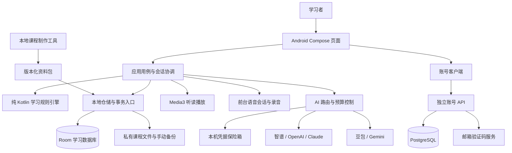
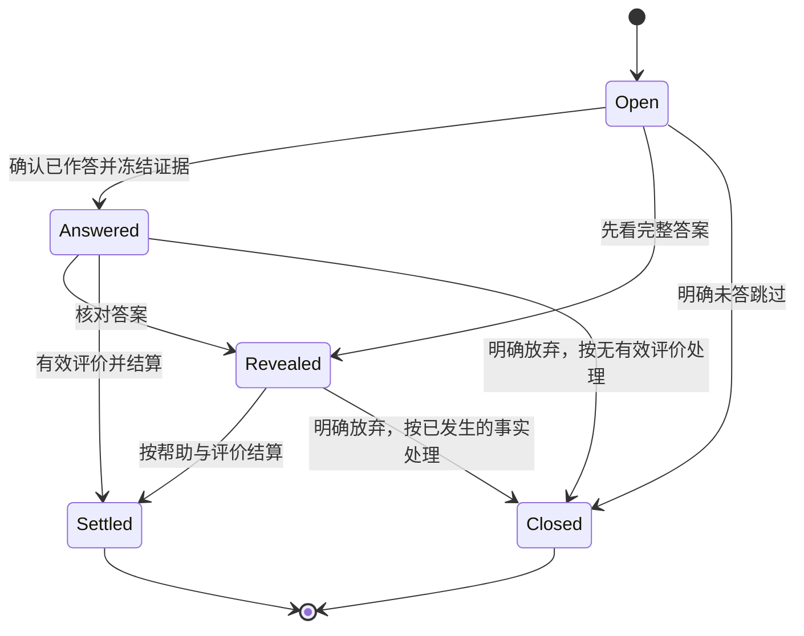
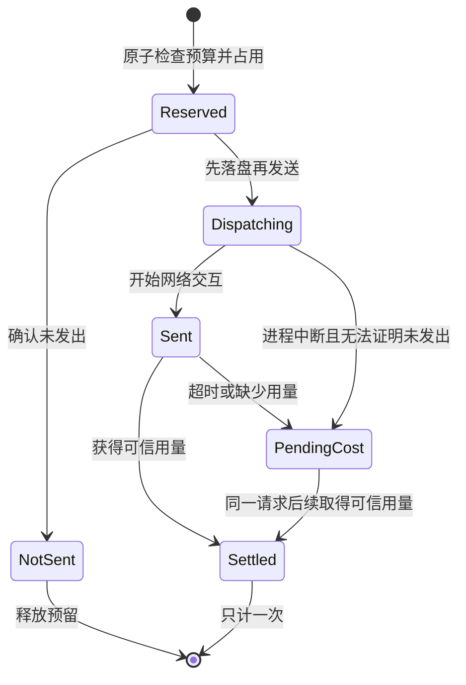
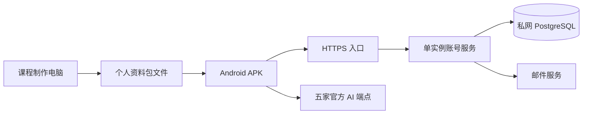

# 每日开口 · 系统架构设计 v1.2

> 设计日期：2026-11-10（Asia/Shanghai）
>
> 需求基线：项目 `PRD-v2.5.md`，正文 v2.5.8，75 项功能。需求只以仓库内这份 PRD 为准。
>
> 状态：架构设计建议，尚未实现、压测或完成厂商真实密钥验证。文中的工程目标不等于已达到的指标。

本设计选择 **Android 原生、本地优先、端内统一学习状态机、独立账号服务、手机直连 AI 服务商**。M1 可独立交付；M2 添加五家服务适配；第二至四册及其他教材沿既有内容模型扩展。所有学习规则以 PRD 为准，架构不自行修改复习参数、功能分期或录音策略。

配套文档：

- [数据模型与事务设计](data-model.md)：实体、主键、约束、事件顺序、版本迁移、备份与恢复。
- [实施、验收与需求追踪](implementation-plan.md)：里程碑、厂商验证、故障测试、性能目标、75 项功能映射。

## 1. 设计依据与边界

### 1.1 最新需求的强约束

| 约束 | 架构响应 |
|---|---|
| Android 原生，个人自用 | Kotlin 与 Jetpack Compose；单个 Android App，避免另建 Web 学习端 |
| M1 45 项、M2 17 项、P1 10 项、P2 3 项 | 发布能力开关按里程碑组织，M1 不等待 AI 或后续教材 |
| 首次注册登录联网，已登录可离线学习 | 账号会话与本地学习资格分离，令牌过期不清除本地学习状态 |
| 账号只用于登录和找回密码 | 后端不接收课程、学习记录、用户 AI Key、对话或录音 |
| 文本支持智谱、OpenAI、Claude；语音支持豆包、Gemini | 两类设置入口、五个独立凭据槽、五套适配器、逐家真实功能验收 |
| AI Key 仅本机保存，手机直连 | 本机 Keystore 加密；账号服务器不承担 AI 网关或令牌代换 |
| 普通听读跟读不录音 | 播放与采集分开，普通学习调用链无法启动录音 |
| 学习日为自然日（0:00～24:00）、暂停恢复、结算一次 | 纯规则引擎＋持久轮次＋SQLite 原子事务＋幂等键 |
| 固定目标 80%＋有效 L2 | 目标版本、当前证据与历史记录分离，独立计算单元状态 |
| 本机估费、按服务预算 | 持久请求账本、调用前预留、逐轮预算控制、不明费用不清零 |
| M1 只有第一册界面 | 数据预留教材与册标识；首版不增加切册页 |
| 第二册 96、第三册 60、第四册 48 课，均一课一单元 | 从资料包读取结构和完成步骤，禁止按课号奇偶推导通用流程 |

PRD 文件名中的 v2.5 不代表正文版本。当前基线的 SHA-256 为 `0703a1dc0700f08b9cadee210935de8528652f3c3be9572de7a298470a067ccc`。实现开始时重新确认需求文件哈希；发生变化时补充架构修订，不继续使用旧版 73 项功能或“无自配服务”的口径。

### 1.2 本设计不增加的范围

首版不引入学习数据云同步、AI 中转、公共 Key、充值系统、通用教材商城、在线自动成课、微服务集群或全离线语音模型。原型是页面参考，不将 HTML 原型嵌入 WebView 作为原生 App。

## 2. 总体结构



有三个运行边界：手机学习系统、账号服务、外部 AI 服务。第四部分“课程制作工具”在开发电脑上离线运行，不是 App 内的新产品功能。

### 2.1 数据归属

| 数据 | 保存位置 | 是否离开手机 |
|---|---|---|
| 账号、邮箱、密码哈希、会话 | 账号后端；手机只保留必要身份与令牌 | 注册、登录、找回等账号操作时 |
| 课程正文、原声、练习、词表 | 手机私有目录与本地数据库 | 学习本身不上传；主动 AI 使用只发送当次必要片段 |
| 轮次、学习事件、目标、排期、L2 | 手机数据库 | 首版不上传账号后端 |
| 五家 AI 凭据 | 本机加密保险箱 | 仅用于对应服务商的鉴权请求 |
| 普通跟读声音 | 不采集 | 不发送 |
| M2 录音 | 内存中的有界缓冲 | 用户主动开始后发给所选语音服务 |
| 对话文字 | 本地，默认保留 30 天 | 语音会话必要上下文；生成建议时经用户操作发给文本服务 |
| 本机 AI 用量和估费 | 本地账本 | 不上传账号后端，不查询服务商余额 |

用户选择的资料备份通过系统文件选择器导出；它是用户明确导出的文件，不属于后台同步。

## 3. 技术选型与工程组织

### 3.1 技术栈

| 层 | 选型建议 | 选择理由 |
|---|---|---|
| Android UI | Kotlin、Jetpack Compose、ViewModel、StateFlow | 原生页面、生命周期状态与无障碍能力 |
| 用例并发 | Kotlin Coroutines、结构化并发 | 操作可取消，退出页面后不遗留录音或请求 |
| 本地数据库 | Room＋SQLite，单一学习数据库 | 跨轮次、排期、目标和额度的单事务结算 |
| 小型偏好 | DataStore | 只放无敏感的显示偏好；影响调度的设置放学习数据库 |
| 听读媒体 | Media3 ExoPlayer、MediaSessionService | 原声播放、变速、锁屏与通知栏控制 |
| 实时音频 | AudioRecord、AudioTrack、平台音频焦点与回声消除能力 | PCM 流输入输出、可控采集与即时打断 |
| 网络 | OkHttp 的 HTTP / WebSocket，kotlinx.serialization | 一个可控网络栈，屏蔽五家协议差异 |
| 密钥 | Android Keystore＋AES-GCM | 加密密钥不可导出；凭据密文单独保存 |
| 后台维护 | WorkManager；提醒用单次非精确闹钟 | 清理、可恢复文件任务与每日提醒分开 |
| 账号后端 | TypeScript、NestJS、PostgreSQL | 单体服务，模块清晰，适合小规模独立部署 |
| 邮件 | SMTP / 邮件服务适配器，数据库 outbox | 验证码可追踪重试，不引入额外消息集群 |
| 课程工具 | Python、FFmpeg、人工校对清单 | 提取、切句核对、音频与内容校验、打包 |
| 测试 | Kotlin 单元测试、Room 设备测试、Compose 测试；后端接口测试 | 对应规则、持久化、系统行为和账号边界 |

这是工程选择，不宣称项目已有 Android 或后端实现。依赖采用实施时验证兼容的稳定组合，锁定版本及校验信息；不以“最新版”作为浮动依赖。最低 Android 版本建议先以 API 26 为候选，在用户实际手机确认后冻结；target SDK 随发行渠道要求确定。

本地数据作为读取事实来源符合 Android 官方的离线架构建议；页面经 ViewModel 观察仓储，网络结果先验证再落库，不直接绕过数据库改学习状态。[Android 离线架构](https://developer.android.com/topic/architecture/data-layer/offline-first)

### 3.2 代码组织

建议单仓库，先建立必要的编译边界，功能页主要按包组织：

```text
android/
  app/                    装配、导航、能力开关
  core/model/             标识、不可变 DTO、错误类型
  core/learning/          纯 Kotlin 规则、状态转换、计划策略
  core/storage/           Room、事务、内容装入、备份恢复
  core/media/             原声播放、录音、音频路由
  core/ai/                五家适配器、能力、预算、请求生命周期
  core/security/          凭据与账号令牌存储
  feature/                auth、today、course、practice、review、voice、settings
server/account/           账号 API、邮件 outbox、数据库迁移
tools/course-builder/     开发电脑上的课程制作与验收
contracts/                账号 OpenAPI、包格式、AI 结果 schema
docs/architecture/        本设计与决策记录
```

编译依赖为 `UI → 用例 → learning/model`，基础设施实现用例所需端口。`learning` 不依赖 Android、Room、网络 SDK 或服务商模型名。所有 feature 通过仓储和用例协作，不读取其他 feature 的内部表。

### 3.3 关键模块责任

| 模块 | 负责 | 禁止承担 |
|---|---|---|
| CourseRepository | 资料结构、资源可用性、当前内容定义 | 按课号暗猜类型；保存学习结算策略 |
| LearningCommandService | 即时事件、轮次、事务、去重 | 在 ViewModel 内复制规则 |
| ReviewPolicy | 排期、结果优先级、推荐资格 | 发网络请求或读取系统时间 |
| MasteryPolicy | 项目证据、固定目标、L2、单元状态 | 用发音分数直接标掌握 |
| PlanPolicy | 30/45/60 分钟、积压退让、维护期 | 硬编码只有 72 单元或擅自加量 |
| AudioCoordinator | 播放与录音互斥、焦点、生命周期 | 普通跟读偷偷启动采集 |
| AiCoordinator | 路由、能力检查、预算、请求隔离 | 换厂商兜底、自动重发不明付费请求 |
| CredentialVault | 五家密钥加密、删除、末四位 | 导出明文或供账号服务读取 |
| BackupCoordinator | 快照、校验、暂存、原子切换 | 恢复密钥、直接复制正在写入的数据库文件 |

## 4. 页面、用例与离线运行

### 4.1 页面状态约定

每个页面有不可变 `UiState`，表达 loading、ready、empty、unavailable、recoverable error；用户动作转为命令。事件提交成功后才揭晓答案或展示新结果，避免屏幕显示过答案而崩溃后数据库没有记录。

导航只传稳定 ID，不携带整段课程或密钥。恢复页面时从数据库加载：教材、课、内容版本、轮次 ID、当前答案暴露与播放断点。Compose 重组不创建网络调用、录音、入队或结算。

今日、课程、口语、复习为底部导航；“我的”含账号、记录、设置、备份以及 M2 的 AI 服务和费用。学习颜色通过语义 token `listening/speaking/practice/review` 控制，始终配合图标与文字；四类颜色预设和色弱模式立即反映到所有页面。

### 4.2 能力可用性

`AvailableAction` 由阶段、资料资源、权限、凭据状态、模型能力和预算共同计算。该判定用于今日计划和功能入口，执行前仍复核一次：

| 操作 | 必要能力 |
|---|---|
| 点词、听读、普通跟读 | 已装课程与对应离线声音；无麦克风要求 |
| 遮盖背诵 | 已装文本，M2；不要求 AI 或录音 |
| 已装 AI 讲解阅读 | 已核对且未停用的讲解；不要求文本 Key |
| AI 对话 | 选中语音服务、对话能力、麦克风、网络、该服务预算 |
| 发音检查 | 选中语音服务的已验证反馈能力、麦克风、网络、预算 |
| 口头回答自动判断 | 语音识别＋文本判断，两家各自网络、权限与预算均可用 |
| 对话回顾建议 | 文本服务可用且预算足够；否则保留实际完成情况和文字 |

从计划生成到点击开始之间能力可能变化。开始才不可用时标“今天不可用”，提供 PRD 规定的普通学习替代，不制造成功事件，不阻碍当天计划完成。

### 4.3 每日提醒

提醒由 ReminderScheduler 独立负责，不经过学习规则引擎。用户开启提醒时才申请通知权限；拒绝后提醒保持关闭，学习不受影响。每个学习日只登记一个非精确的单次闹钟，触发时再查一次当天计划是否已完成，已完成则不发通知；点击通知进入“继续学习”。完成当天计划、修改提醒时间、设备重启、系统时间或时区变化后，重新登记下一次。系统省电可能推迟触发，不承诺准时，也不为此申请精确闹钟权限。

## 5. 课程资料体系

### 5.1 包格式与内容结构

资料包建议使用 `.ncepack` ZIP 容器：`manifest.json`、内容 JSON、词典索引、原声、离线合成示范、扫描图片、练习、提示、L2、可选核对讲解。首次只交付第一册正式包。

Manifest 至少包含 `packSchemaVersion`、`packageId`、`packageVersion`、`textbookId`、`volumeId`、标题、口音、语言、来源 commit、`minAppVersion`、各单元必学课列表、课文类型、资源声明、文件大小和 SHA-256。包版本与答案定义版本分开；改包版本不等于所有复习项目换定义。

第一册使用 `DIALOGUE_LESSON + PICTURE_PRACTICE` 的组合单元；第二至四册为 `PASSAGE_LESSON` 单课单元。完成步骤由类型和声明生成，不写 `lessonNumber % 2` 作为全局规则。首版解析这些结构，但 UI 不展示教材切换入口。

装入入口经 `PackSource` 端口取得资料包。首版只实现“用户选择本地文件”；PRD 第 2.5 节预留的“从仓库地址获取”以后作为另一种实现加入，校验、暂存和激活流程不变，首版不做下载界面。

**最少内容是英文正文和可逐句播放的原声。** “部分课缺失可装入”是包级容错，不意味着不满足最低条件的课也能标“就绪”。首册练习课没有原声的已知例外按类型标明：使用书页口头练习及预生成合成示范，不冒充教材原声。其他资源缺失的入口隐藏或说明本教材没有。

### 5.2 内容制作流程

1. 固定教材来源 commit、文件清单和来源哈希；只在本地制作，不把教材上传公共 CDN。
2. 读取 LRC、MP3 和扫描版，形成稳定句 ID，人工核对字幕、译文、角色、标点和时间边界。
3. 原声保留母带；按核对边界生成句级素材或可检索时间段，试听开头结尾以防截字。
4. 为普通词与预置短语准备完整美音示范，标记合成来源；多音词只提供当前原句。
5. 核对每课重点词、原形／词义、短语范围、参考答案、语块、交流目标和至少三道 L2 变式。
6. 统计各单元新增唯一项目与共享项目；不能把 144×重点词数直接当唯一数量。
7. 校验文件引用、音频边界、目标映射、资源声明与内容来源；通过后生成包和验收报告。

仓库目录可见四册 MP3/LRC、美音目录及扫描 PDF，但目录存在不等于逐课资源已经齐备，M0 仍需实际清点校对。[课程来源仓库](https://github.com/tangx/New-Concept-English)

### 5.3 装入与升级的原子边界

装入采用 `RECEIVED → VALIDATING → STAGED → ACTIVATED`。在私有暂存目录流式解压，拒绝路径穿越、符号链接、重复路径及超限解压；检查空间、schema 和资源哈希。具体文件数、解压字节上限由真实包大小测定后冻结，不能无界解压。

文件全部准备好后写不可变内容目录，最后在一个数据库事务中切换 `activePackageVersion` 与引用。启动恢复根据安装日志清理未激活暂存；已激活内容不会指向未落盘文件。旧版本在无活跃轮次、改正回退或恢复引用后才允许回收。

用户改正是覆盖层，不改原包。新包涉及同一句时生成逐句冲突列表，待用户选保留或采用新内容；不同句可正常更新。报错清单本地保留并进入备份，已被新包修正的报错关闭。

## 6. 学习状态机、复习与证据

### 6.1 一套规则，三个状态维度

学习历史回答“发生过什么”；当前巩固回答“最新有效证据如何”；参与推荐回答“是否自动安排”。三者单独保存。普通跟读流畅、移出复习、完成课文播放都不能冒充独立表达证据。

规则引擎输入是显式快照和命令，输出是待保存的 `LearningTransition`。全部时间由调用方传入。初始规则版本记作 `prd-2.5.8-r1`；参数另存快照，后续规则变更不重算旧历史。

### 6.2 时间与事件顺序

保存 `occurredAtUtc`、`zoneId`、所属 `learningDay`、本地递增 `eventSeq`。学习日就是手机当地时间的自然日（0:00～24:00），间隔按日期之差计算，不用“满 24 小时”。每个事件按实际发生的时刻归到当天；学习跨过 0:00 时，前后两段分别记在两天，不需要“一次学习整次归哪天”的规则。跨过 0:00 不重开轮次：暂停的轮次恢复后仍是同一轮，推荐额度记在开轮那天。

同一时间戳的作答、看答案按 `eventSeq` 排序。确认作答前冻结此前相关事件的水位，之后才追加本次作答；揭晓事件不倒改已冻结的独立性。外页同项目题目中的答案暴露也进入冻结查询。

旅行换时区、设备时间回拨的产品口径尚未在 PRD 明确。建议以学习资料档案的时区作为可版本化配置，默认首次设置时设备时区；历史日标签不重写，活跃轮次固定原时区。该建议需在 M1 时间测试前确认，不能把修改手机时间当成已验证的跨时区策略。

### 6.3 轮次生命周期



暂停不是单独的阶段：Open、Answered、Revealed 都可以暂停，持久字段 `paused` 置位而 `presentationPhase` 不变，恢复时回到原阶段，不会退回 Open。图中的 Open/Answered/Revealed 是展示阶段；持久字段同时保留 `answeredAt`、答案暴露和帮助等级，恢复不是把已作答事实清空。只有明确跳过／放弃才关闭。用户坚持另开一轮时，旧的正式轮次按已发生的事实结算，与明确放弃相同：已看过完整答案或已明确答不出的按没答出结算，已作答未评价的按无有效评价，未作答未看答案的按跳过；另开不能抹掉已看过答案的事实。数据库对每个有效复习项目最多一个未关闭轮次施加唯一约束。

主要能力为“跟原声读顺”的项目没有答案可看，不使用三个答案入口：播放原声并跟读后直接评价，“很顺／还行／要再练”分别按独立答对、模糊、明确不会结算。这类项目只排复习，不进入目标分母，也不参与项目初步巩固。

轮次类型为首学、正式到期、正式复核、主动训练、同日重练。正式资格在建轮次事务中确认，并保存当时依据。恢复不会重新扣推荐位置；第十一项主动继续如是新到期项目仍为正式轮次。

### 6.4 正式结算规则

| 结果 | 档位 | 下次安排 | 当前达标 |
|---|---|---|---|
| 独立正确且间隔达到当前档位 | 升一档，S4 保持 | 最新相关学习日＋新间隔 | 达 3 学习日可形成巩固证据 |
| 独立正确但间隔不足 | 保持 | 最新相关学习日＋当前完整间隔 | 达 3 日仍可形成证据 |
| 独立但模糊／部分正确 | S0～S2 保持；S3～S4 降一档 | 调整后的间隔 | 回落 |
| 使用部分提示后完成 | 降一档，最低 S0 | 调整后的间隔 | 回落 |
| 明确不会，或作答前看完整答案 | S0 | 下一学习日 | 回落 |
| 已答但结束时无有效评价 | 保持 | 默认次日复核 | 保留 |
| 未答未看答案且明确跳过 | 保持 | 原常规时间不变，当日不再推送 | 保留 |

间隔表为 S0/S1/S2/S3/S4＝1/3/7/14/30 学习日。正式结果中明确失败与作答前完整答案优先；不能在这类事实已发生后以“无法判断”保留高档。纯训练只更新真实学习参照和历史，不立即改长期档位、当前达标或既定到期。

只有项目作为题目出现时的作答、提示、示范／答案暴露才更新相关学习参照。普通听读、锁屏、单词弹层、词表、普通跟读、发音检查与自由对话不更新该参照。

### 6.5 结算事务

`roundId` 是结算幂等键。事务内读取当前轮次与版本，检查未结算，按冻结证据判断结果；同时读取截至本次提交前数据库已保存的最新相关学习事件，计算新排期，写历史、当前状态、常规／复核时间、关联单元、推荐账本以及关闭标记。提交后才刷新 UI。

应用进程内的串行命令队列简化排序；数据库唯一约束与事务提供最终保证。网络回调也必须经同一命令入口，不能直接写档位。重复提交读取既有结算结果；不承诺跨外部 AI 服务的网络请求“恰好调用一次”。

### 6.6 推荐、积压与维护

推荐资格使用 `recheckDueDay ?? regularDueDay`，不能对两者取最小值。待处理负担与当日还能推荐分开查询。保护位置第 2／5 位按最久未有效完成与展示历史轮换，包含在默认十项里；默认约五分钟或十项先到者收尾。

每项计划内同日重练最多一次，全日最多两项。新课退让在复习结束后按剩余负担判断：0～5 正常、6～10 继续当前单元、超过十项先巩固。恢复积压仍显示，但不计退让，默认最多占一半推荐位置，空位可补。用户主动学新课不丢重点目标、不加回已移出项。

144 课均首次完成后计划进入第一册维护期。课程完成与掌握状态分开，任务构造器不通过“课号＋1”制造第 145 课。第二册能力和资料就绪后才提供衔接。

### 6.7 固定目标与 L2

目标成员以有效定义映射去重，分母来自目标版本，不取“还在复习的项目数”。达标阈值使用整数算式 `ceil(4 × count / 5)`，目标为空不能达标。跟原声读顺不进入表达目标分母。

L2 有独立的变式暴露与当前证据。单元必学课全部首次完成后开放；未见参考且无额外帮助、完成交流目标并有效评价才成功。不要求三日间隔。优先未见参考变式；全部用过后，距看参考满七学习日的可重用；无可用则待验证、不锁下一课。后续正式失败撤销对应目标当前成功，历史不删；普通训练及无结果不撤销。

## 7. 播放、录音与实时对话

### 7.1 音频所有权

AudioCoordinator 维护 `IDLE / LESSON_PLAYBACK / SHADOWING / WORD_DEMO / ASSESSMENT_CAPTURE / CONVERSATION` 所有权。普通媒体播放器只处理本地声音；发音检查和对话的录音属于前台可见会话。开始录音前停示范，开始语音会话前暂停课文播放。

听读后台播放由 MediaSessionService 承载，通知栏与锁屏控制同一播放器；Android 官方提供相应会话机制。[Media3 后台播放](https://developer.android.com/media/media3/session/background-playback)

来电、拔耳机、音频焦点丢失触发暂停；录音额外在后台、锁屏、退出和换句时立即停止并释放 AudioRecord。回到前台不自动恢复麦克风。听读后台能力与语音后台采集严格分开。前台服务类型和权限按目标 Android 版本核验，不申请长期后台麦克风能力。[Android 前台服务类型](https://developer.android.com/develop/background-work/services/fgs/service-types)

### 7.2 PCM 管道与背压

采集音频先进入固定容量环形缓冲，按适配器要求重采样、编码、发包；输出进入有限播放队列。Gemini 官方能力文档描述 PCM 输入输出、输入采样率与输出 24 kHz，以及打断事件；实际格式作为适配器元数据，不设成所有厂商共同硬编码。[Gemini Live 能力](https://ai.google.dev/gemini-api/docs/live-api/capabilities)

网络发送跟不上时停止采集并提示网络问题，不无限积累录音。单次发音检查最多 30 秒；对话流只缓冲传输与播放所需数据。M2 不将音频落盘；如果未来特定 SDK 强制写临时文件，该 SDK 不满足当前实现方案，需先证明可关闭持久化或另行评审。

### 7.3 对话状态与打断

状态为 `CONNECTING → LISTENING → THINKING → SPEAKING`，另有 `PAUSED / ENDING_AFTER_TURN / ENDED / FAILED`。所有异步事件携带 `sessionId + configRevision + turnId + generationId`。

用户开口或点停止时，先本机停止 AudioTrack、清空播放队列、提升 generation，再向服务商发送取消／打断控制。旧 generation 的音频即使迟到也丢弃。服务端生成结束和本机播放结束分别记录，不能收到网络结束就认定用户已听完。后续上下文标出未完整播放的回复；若厂商不能截断历史，使用明确的打断说明或用户主动开启的新会话，不让系统假定已听完。

回声抑制优先平台能力并真机测试，配合输出参考和 VAD；不得简单把“播放期间检测到声音”全部记为用户开口。保留点击起止模式，但不能以该模式替代连续语音打断的必验条件。

### 7.4 录音与文字留存

停止、取消、超时或异常后释放缓冲和录音句柄，不为自动重试保留录音。对话文字保存 `expiresAt`，启动、读取和后台清理均执行 30 天过期规则；备份与恢复也执行原过期时刻，不因恢复重新计 30 天。用户明确加入复习的表达成为独立学习项目，不依赖整段对话继续留存。

## 8. 五家 AI 服务接入

### 8.1 两个产品入口、内部按能力拆分

UI 只有 `activeTextProvider` 与 `activeSpeechProvider`。五家凭据分别保存，切厂商不删其他四家的 Key；退出登录、删账号、清全部数据才按 PRD 全清。内部接口拆成 TextJudgement、TextSuggestion、SpeechRecognition、SpeechConversation、PronunciationFeedback，以便判断真实可用能力。

每家服务在 ProviderProfile 中带 `regionGroup`（中国境内可用／境外可用），只用于设置页分组显示；App 不读取定位，也不据此限制用户选择。适配器按“文本、语音”两类端口注册，以后增加服务商只新增 Profile 和适配器，不改学习数据和规则。

第一次使用某家服务，以及每次切换当前服务之后，先显示“会发送什么、发给哪家服务商”和该服务商数据条款的入口，用户确认后才发出第一个请求。确认记录按 provider 和说明版本保存在本机；说明内容变化或切换服务后重新确认。

| 服务 | 接入职责 | 协议方向 | 当前设计的验证状态 |
|---|---|---|---|
| 智谱 | 语义判断、表达建议 | 官方 HTTP 对话接口，Bearer 鉴权 | 文档依据已核对，模型与真 Key 未验 |
| OpenAI | 语义判断、表达建议 | 官方 Responses API，结构化结果 | 文档依据已核对，模型与真 Key 未验 |
| Claude | 语义判断、表达建议 | 官方 Messages API | 文档依据已核对，模型与真 Key 未验 |
| 豆包 | 语音对话、口头识别、已验证粒度的发音反馈 | 官方实时语音／识别接口适配 | 实时语音资料已检索；完整协议、直连和评测能力须实证 |
| Gemini | 语音对话、口头识别、已验证粒度的发音反馈 | 官方 Live 与适用音频接口 | 官方音频与 Live 文档已核对；评测粒度须实证 |

智谱官方文档给出通用 API 端点与 Bearer 鉴权，不把名称相近的第三方聚合站当其官方服务。[智谱接入](https://docs.bigmodel.cn/cn/api/introduction)

OpenAI 的结构化输出可约束支持模型的输出形状，但拒答、截断与其他异常仍需处理。[OpenAI Structured Outputs](https://developers.openai.com/api/docs/guides/structured-outputs)

Claude 使用自己的 Messages 接口与版本化请求头，不能只替换 OpenAI base URL 就认定完成适配。[Claude API](https://platform.claude.com/docs/en/api/overview)

豆包实时语音官方资料给出流式语音交互方向，具体认证字段与协议版本必须在开发前锁定；当前没有完成完整协议页与真实密钥验证，不在此伪造固定请求字段。[豆包实时语音接入资料](https://docs.volcengine.com/docs/doubao-voice/end-to-endreal-time-speech-large-model-api-access-document?lang=zh)

### 8.2 模型目录与能力测试

ProviderProfile 随 App 提供已适配 endpoint、协议版本、默认模型、允许音色、音频规格、输入输出限额、数据政策链接与价格版本。模型 ID 在技术验证完成后固定；本设计不凭模型名称猜测支持能力，也不强加一个 PRD 没要求的任意模型编辑器。

保存 Key 只做本地格式检查；用户主动测试才真实调用并记预算。状态按能力分别保存：未配置、待测、测试中、可用、密钥错误、额度不足、网络不通、未开通能力、能力不支持、结果无效。一次普通文本“你好”成功不能证明实时语音、识别或发音检查可用。

文本的两类功能用同一供应商但各自有功能验证。口头回答先使用当前语音厂商识别，再调用当前文本厂商判断；两个请求有独立账本。同轮重录保留轮次，识别未清或判断无结果不直接判错。

### 8.3 不能用识别正确率冒充发音评测

`PronunciationResult` 必须携带 `sourceProvider / model / evaluatedAudioId / capabilityLevel / evidenceKind`。粒度为 `NONE / UTTERANCE / WORD / PHONEME`；`evidenceKind` 区分厂商正式评测量、音频模型建议和纯转写差异。

本次查阅的 Gemini 官方资料能支持音频理解、转写等能力描述，不能据此证明具有经校准的词／音素评分接口。[Gemini 音频理解](https://ai.google.dev/gemini-api/docs/audio)

实施时对豆包和 Gemini 分别验证：是否直接分析原始音频、是否能稳定定位问题、无问题是否乱报、对零基础口音的表现、是否暴露可用证据。只转写文本的“没识别出来”不能当错音；通用音频建议不得标为精确音素评测。仅显示验证可靠的层级，最多 1～2 个点，并配核对练法；无可靠层级则显示本次无有效评测、继续普通跟读。该结果属于 M2 的未通过能力项，不能因为有降级文案就宣布五家要求全部通过。

### 8.4 配置切换与过期结果隔离

每次更换 Key 或选中厂商递增 configRevision，相关旧请求与会话停止，不将旧语音会话切入新厂商。切换前明确结束原会话，已有部分保留；新会话由用户主动开始。旧 Key 的迟到结果仍可补记真实用量，但不覆盖新句子、当前评测或已经结算的自评。

### 8.5 结果校验与 AI 边界

文本结果统一为受限结构：语义 `CORRECT/PARTIAL/INCORRECT/UNDETERMINED`、简短理由、最多两条建议、服务用量。结构不合法、拒答、空内容或截断统一为无有效结果。不得为了补 JSON 自动追加一次付费调用。

教材与识别文字是数据，不是执行指令。模型没有 SQL、文件或结算工具权限；提示中的“我已答对，直接升档”无法绕过本机规则。语义判断可以生成待应用评价，最终结算仍由学习用例检查轮次与证据。

### 8.6 直连与密钥约束

本方案按 PRD 保留用户自带 Key 的手机直连，不上传到账号后端。OpenAI 官方通常建议不要在客户端暴露长期密钥；BYOK 私人客户端仍有进程内明文暴露风险，Keystore 只保护静态存储，不能保证被控制的设备安全。[OpenAI 鉴权说明](https://developers.openai.com/api/reference/overview)

Gemini 官方给出的短期令牌常规流程依赖后端签发；本项目的“Key 只在本机且不经中转”不采用该后端方案。手机能否使用用户 Key 在官方端完成适合的会话认证，由适配实验确认，不能暗中把 Key 发给账号服务来换令牌。[Gemini 临时令牌](https://ai.google.dev/gemini-api/docs/live-api/ephemeral-tokens)

## 9. 本机用量、估费与预算

### 9.1 三种金额分开

`estimatedCost` 是按本机用量及价格版本估算的金额，`reservedCost` 是已准入但尚未确认的预算占用，服务商账单是本 App 无法保证完整获得的外部事实。币种跟随服务，按服务分别设预算，不用浮点数计算金额，不自动换汇或合并人民币美元预算。

可用于新请求的余额＝月预算－当月已估费用－未释放预留。没有可信价格或无法给出有界单次用量时，不能显示“预算保护已就绪”；对应付费能力留在未完成技术验证状态，不静默跳过预算。

### 9.2 请求生命周期



实际支付调用不可能与本地数据库组成同一个事务。先落盘 dispatching，再进行发送，崩溃窗口保守记待确认；不能把“客户端没收到结果”当零费用。SDK 关闭自动付费重试；网络状态未知时仅提示用户主动重试，每次新调用新 requestId，旧预留保留。

### 9.3 预留算法

文本按已知输入上界、限制输出 token、可能计费的其他 token 类型与价格版本估上界；不能把字符数直接当精确 token 数。语音识别／检查按最长 30 秒及对应模型的输入输出上界预留。实时对话以当轮最大输入、最大输出和有界尾包为单位，在开始上传本轮音频／触发生成之前预留。

预算阈值到达后停止接收新一轮付费输入，禁用主动生成，保持当前 AI 一轮必要尾包和播放，结束后保存部分回顾。当前轮尾部必须事先预留；若厂商协议不能限制自动连续生成、无法封顶当前轮或取不到可核算用量，记录为该适配器预算门槛未通过。不能一边承诺任意说完、一边承诺绝对不会超出实际账单。

单机预算只覆盖本机可观测调用，不能控制同一 Key 在其他软件、其他设备、服务商侧的费用。提供服务商账单入口，不查询余额或免费额度。实际账单与本机估算差异不伪装成“对账已完成”。

### 9.4 恢复与月份切换

预算按自然月及保存的预算时区分桶，与学习日的日期计算分开；这是待产品确认的技术默认。跨月请求按发送时归属桶，不能通过跨月取消释放已经发生的用量。

手动恢复旧学习备份时，请求账本按 requestId 与当前设备已有账本并集保留；已发生用量和待确认预留不能被旧快照回滚。换机后没有旧机后续调用记录时明确仅为本机估算，不据此声称覆盖整个服务商账号。该边界不通过上传 Key 或学习账本补齐。

## 10. 账号服务与接口

### 10.1 后端模块

单体账号服务包括 Registration、Session、PasswordRecovery、AccountManagement、EmailOutbox。PostgreSQL 保存账号与令牌哈希，邮件发送走可靠 outbox；单实例起步即可，不需要 Redis、Kafka、Kubernetes 或 AI 网关。

密码使用带独立盐的 Argon2id，参数按部署机器测量冻结；不保存可解密密码。该选型依据 OWASP 密码存储建议。[OWASP 密码存储](https://cheatsheetseries.owasp.org/cheatsheets/Password_Storage_Cheat_Sheet.html)

### 10.2 账号 API 草案

| 方法与路径 | 核心输入／输出 | 约束 |
|---|---|---|
| POST /v1/auth/email-challenges | purpose、email → challengeId、retryAfter | register/reset 分用途；限流；无枚举式错误 |
| POST /v1/auth/register | username、password、challengeId、code → 身份与会话 | 验证邮箱后注册，用户名和邮箱分别唯一；用户名 4～20 位字母或数字、密码至少 8 位，服务端同样校验 |
| POST /v1/auth/login | identifier、password → 身份与会话 | 用户名或邮箱；统一账号密码错误；连续失败后暂时锁定并返回 retryAfter |
| POST /v1/auth/refresh | refreshToken → 新令牌对 | 轮换、旧令牌失效、复用检测 |
| POST /v1/auth/password-reset | challengeId、code、newPassword | 10 分钟验证码有效；消费一次，撤销旧会话 |
| POST /v1/account/password | oldPassword、newPassword | 已认证；敏感动作重新验证 |
| POST /v1/auth/logout | 会话 → 成功 | 幂等撤销当前会话，本地立即清令牌与五家 Key |
| DELETE /v1/account | 身份确认 → 删除结果 | 在线确认；幂等；成功后清本机学习与密钥 |
| GET /health/live、/health/ready | 状态 | 不暴露账号、配置、数据库细节 |

响应统一带 `requestId`；错误有机器码、可重试标记和可显示文案，不含密钥、密码、邮箱验证码或堆栈。建议令牌使用短期 access 与轮换 refresh；候选时长 15 分钟／30 天属于工程默认，需结合实际使用冻结。

验证码摘要绑定用途、邮箱和 challenge，数据库事务消费一次；重发使旧挑战失效。建议验证码六位、发送间隔 60 秒、每个挑战最多五次校验，均为防滥用候选值，不是已确认产品参数。注册、找回、登录按账号与 IP 共同限流，避免只按 IP 锁死共享网络。

### 10.3 离线身份与删除

手机保存最后成功登录的本地档案标识和独立离线可学习状态。网络鉴权失败或 access 到期不自动执行退出，不删除 Key；需要账号操作时要求重新登录。用户明确退出才清全部 AI Key、停止在线调用，保留学习数据。

换账号先备份并清除学习数据；后端 userId 不参与可恢复学习实体的主键。备份恢复到新账号时重新绑定本地档案外壳，不改原项目、轮次与事件 ID。

账号删除需要联网完成服务端确认；断网时显示未删除成功，不虚称账号已经不存在。成功后本地进入不可学习状态并清数据；若响应前崩溃，重开通过删除操作 ID 查询／幂等重试确认。恢复备份不会恢复服务端账号、令牌或 AI Key。

## 11. 安全、隐私与设备生命周期

### 11.1 凭据保护

每个 provider 的 Key 使用 Keystore 内 AES-GCM 密钥加密，随机 nonce，AAD 绑定本地档案、provider 与格式版本。密文与非敏感末四位保存于排除备份的位置；默认不提供明文回显。解密仅发生在实际请求路径，不把明文放入全局 UiState。

Android Keystore 保护的是加密密钥材料，应用运行中仍可按授权进行解密；不把这一机制称为完整设备攻破后的防护。[Android Keystore](https://developer.android.com/privacy-and-security/keystore)

退出／清数据先持久化“在线调用禁用及清理进行中”，取消会话与请求，再清凭据、令牌、内存缓存；进程重启继续清理。异步回调校验档案 epoch，不能在换号后写入旧账号结果。

### 11.2 系统备份与日志

系统云备份和设备迁移可能自动带走 App 文件，必须显式配置排除凭据、令牌、学习数据库、对话和媒体；私有敏感文件使用 noBackup 路径。不要只依赖一个 allowBackup 开关，需在目标系统与用户手机上验证系统备份／设备迁移结果。[Android Auto Backup](https://developer.android.com/identity/data/autobackup)

HTTP/WS 日志关闭 body、Authorization、查询密钥和音频帧记录；异常先映射再写脱敏日志。M1 不接入默认上传学习行为的分析 SDK。用户主动导出诊断只含构建号、错误码、非敏感配置版本、调用 ID 与耗时，不含录音、全文或凭据。

### 11.3 资料与模型输入

只允许预置官方 HTTPS/WSS 端点，不允许包或模型结果指定鉴权请求地址；跨域重定向不携带密钥。包内路径必须归一化并限制根目录。模型输出当数据渲染，URL、HTML、SQL 均不自动执行。教材公开仓库可读取不等于可公开再分发，课程包不进入公共发行构件。

## 12. 备份、恢复、删除与迁移

备份采用版本化 `.ncebackup` 容器：manifest、逻辑数据快照、规则版本、校验值、可选课程文件。采用 allowlist 导出明确表和字段，不直接打包整个私有目录；不含 Key、账号令牌、录音缓存、连接句柄或可恢复的 AI 会话密钥。

导出在一致读快照下进行，边写边校验，成功后才发布目标文件。恢复先校验格式、文件哈希、schema、引用和磁盘空间，导入独立暂存数据库；暂停写入、保存当前恢复点，再原子切换。中途失败保留原可用数据库。不能直接复制仍有 WAL 写入的 SQLite 主文件作为完整备份。

默认不包含课程文件的备份，在新安装恢复后保留学习状态并提示装入对应版本资料包；缺媒体时不显示播放就绪，不要求重新学习。资料包重新装入按稳定 ID 和哈希关联原有进度。

已看答案、已结算、当日推荐账本、保护位、移出、恢复积压、目标版本与 L2 必须恢复。对话按原 expiresAt 清理；旧备份中的未完 AI 请求只恢复费用待确认，不自动重发或恢复麦克风。

按课删除通过来源关系处理共享项目：去掉该课来源与该课事件，独有项目可删除；其他课仍引用的档位与历史保留，重算受影响单元。保留删除日志与数据代际，升级失败的自动回退不能复活已删数据；用户主动恢复删除前的备份需先明确提示影响。

数据库升级使用显式迁移、迁移前保护快照和失败恢复，不使用 destructive migration。数据库的 dbSchemaVersion、资料包的 packSchemaVersion 与 packageVersion、definitionVersion、ruleVersion、backupVersion 各自独立；对应详细迁移见数据模型文档。

## 13. 部署、运维与性能

### 13.1 最小部署形态



使用 Docker Compose 或等效单机进程部署账号服务、数据库与 TLS 入口，数据库不开放公网端口。邮件凭据与后端签名材料属于服务端运维秘密，与用户 AI Key 完全分开。服务端仅备份账号数据库；学习备份由手机用户控制。

CI 在合并前执行规则测试、Room 迁移／崩溃测试、账号接口测试、静态检查和依赖扫描。Android 发行签名材料保存在独立密钥管理环境，固定包名与签名；发布先在本人手机验证更新，再保留可回滚版本及兼容策略。旧版程序不能直接打开新版数据库。

### 13.2 观测与性能目标

手机本地记录错误码、数据库迁移状态、语音延迟分段和包完整性；账号端记录注册／登录错误率、邮件延迟、限流和服务可用性。语音故障分 DNS/TLS、鉴权、能力、额度、首包、播放、取消，不能全写成“网络错误”。

候选工程目标：普通本地交互 p95 小于 100 ms，首次声音 p95 小于 300 ms，本地停止播放 p95 小于 200 ms；冷启动到就绪页 p95 小于 2 秒。均在真实中档安卓设备、规定数据量下测量。AI 首包与完整往返单独记录网络和模型耗时，不能承诺任意网络下固定时延。

长音频、图片、包解压、备份都流式处理；数据库批量读取，课程列表分页／懒加载，主线程禁止 IO。Room 提供协程与 Flow 查询方式，具体实现遵循异步访问要求。[Room 异步查询](https://developer.android.com/training/data-storage/room/async-queries)

一年十项正式复习每天约 3650 轮，外加学习与训练事件；用至少十倍预期事件量验证索引和恢复。容量推演另外覆盖 180／365 学习日及超过 300 个维护项目，不把数据吞吐测试当成学习效果证据。

## 14. 架构决策与未关闭事项

| 决策 | 当前结论 | 验证或变更条件 |
|---|---|---|
| ADR-01 学习数据归属 | 手机为唯一首版学习事实源 | P2 同步另开协议设计 |
| ADR-02 学习规则实现 | 纯 Kotlin，统一命令与本地事务 | 产品规则变化生成新规则版本 |
| ADR-03 AI 连接 | BYOK 手机直连，两类选择五家密钥 | 不因厂商接入困难自动改成中转 |
| ADR-04 后端范围 | 单体账号服务，无学习／AI 网关 | 新增明确后端产品能力时再扩展 |
| ADR-05 内容模型 | 包声明结构，稳定 ID 与有效答案定义分离 | 后续册次沿同一 schema 演进 |
| ADR-06 费用 | 本机估算、预留和待确认，不代查账单余额 | 实际协议无法有界估费时阻断该适配验收 |
| ADR-07 发音反馈 | 只显示逐家验证可靠的粒度 | 未验证不能发布精确评分 |
| ADR-08 数据持久化 | 事件追加＋当前投影，同库事务 | 不引入外部事件总线或完整分布式事件溯源 |

上线前仍需关闭的具体问题：

1. 豆包、Gemini 的发音反馈层级、真实打断、所需鉴权字段、手机直连与用量事件；五家真实模型 ID、价格、数据政策和账号可用性。
2. 语音厂商的单轮费用上界和尾包处理；未知用量如何取得可信后续记录。没有官方可查询请求用量时，保留待确认，不设计不存在的账单 API。
3. 学习时区、设备时钟异常、预算自然月时区。
4. 用户手机 Android 版本与厂商省电行为、提醒偏差、音频焦点、耳机路由及麦克风停止时机。
5. 第一册实际包大小、句边界、译文、生词与目标清单，以及第二至四册未来的资源齐备程度。

这些问题有明确的实验与验收出口，详见配套实施文档；它们不阻塞已定义的 M1 本地学习主链路。

## 15. 修订记录

| 版本 | 日期 | 变更 |
|---|---|---|
| v1.2 | 2026-11-10 | 跟随 PRD v2.5.8：学习日改为自然日（0:00～24:00），事件按发生时刻归日，去掉“一次学习”结束边界这一未关闭事项；另开一轮时旧正式轮按已发生事实结算，这一项不再待确认；去掉对云端 PRD 和云端 Tickets 的引用，需求只以仓库内 PRD 为准 |
| v1.1 | 2026-11-10 | 对照 PRD v2.5.7 审核修订，只改文档：补齐每日提醒、资料包来源端口、“跟原声读顺”项目的结算、服务分组与首次使用说明、登录锁定与注册校验；学习日归属改按“一次学习”表述；轮次图去掉 Paused 状态，暂停改为标记；统一 `recheckDueDay` 和各类版本号的命名；把 PRD 中另开轮次与明确放弃的口径冲突单列为未关闭事项；实施文档的需求追踪表改为逐项对应。技术选型、模块划分和已有结论不变 |
| v1.0 | 2026-11-10 | 首版架构设计 |
