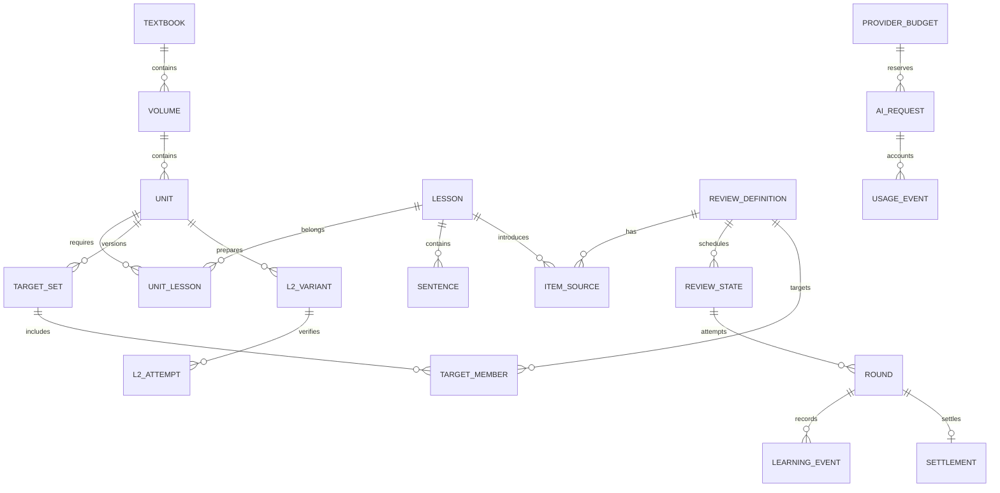

# 数据模型、事务与版本演进

> 架构 v1.2 配套，基于 PRD v2.5.8。本文是实现契约草案，不是已创建的数据库。名称表达实体含义，最终 Room 类名可遵循项目命名规范。

## 1. 存储布局

```text
App 私有目录/
  content/{packageId}/{packageVersion}/   校验后的不可变媒体和内容文件
  staging/                              未激活装包与恢复暂存
  databases/learning.db                  课程索引、学习、规则、估费账本
  datastore/display.preferences          非敏感显示偏好
  no_backup/credential-vault/            五家凭据密文、账号令牌
  no_backup/recovery/                    升级保护与删除代际记录
```

`learning.db` 是学习事务边界。资料大文件不塞进数据库，但元数据、活跃包指针、有效定义和学习状态放在同库；纯内容目录按版本不可变。系统自动备份排除上述敏感目录，用户手动备份按字段白名单生成。

数据库建议启用外键、WAL；事务内不做网络或大文件 IO。唯一约束解决最终竞态，不只依赖内存锁。部分唯一索引若所用 Room 版本不能声明，使用版本化 migration 显式创建并通过设备测试验证。

## 2. 标识和版本

| 标识 | 含义 | 稳定性 |
|---|---|---|
| profileId | 本机学习档案，一台手机同一时间只有一个 | 不等于后端 userId；换号或恢复备份时重新绑定 |
| textbookId | 教材系列，如新概念 | 与中文标题、目录名解耦 |
| volumeId | 册／资料范围 | 不因重装或改名改变 |
| unitId | 单元 | 由包声明，两课／一课结构均支持 |
| lessonId、sentenceId | 课与句 | 不用数组位置作主键，重排不变 |
| canonicalItemId | 经过确认的词义／句义／短语身份 | 不是英文小写字符串；同形异义不同 ID |
| shareScopeId | 状态共享范围 | 首版限定已明确的第一册；跨册共享策略以后决定 |
| definitionId | 一个具体考核定义 | shareScope＋canonicalItem＋primaryAbility＋definitionVersion |
| targetSetVersionId | 单元标准／自定义目标集合版本 | 成员变更生成新版本 |
| roundId、commandId | 一轮学习与一次用户命令 | 在进程重启和备份恢复后保留 |
| eventId、eventSeq | 事实唯一标识与本地提交顺序 | ID 可跨备份识别，Seq 在档案内递增 |
| requestId | 一次可能付费的服务调用 | 与服务商 request ID 分开保存 |
| profileEpoch | 本机档案生命周期 | 换号、恢复、清除时递增，隔离旧回调 |

`packageVersion` 表示资料发行，`packSchemaVersion` 表示资料包格式，`definitionVersion` 表示有效答案／能力，`ruleVersion` 表示排期规则，`dbSchemaVersion` 表示数据库结构，`backupVersion` 表示备份格式。它们各自独立，不能互相代替。

跨册未来可以通过显式映射合并状态；首版只保留足够身份信息，不提前把不同册同拼写单词合并。跨课已确认的同义、同能力、同定义则按 PRD 共享。

## 3. 实体关系



图表示主要业务关系，完整键需要同时包含本地档案或册的范围。不能因为某个图上省略范围字段就在实现中做全局共享。

## 4. 内容与学习进度表

### 4.1 课程和资源

| 表 | 核心字段 | 约束／索引 |
|---|---|---|
| textbook | textbookId、title、sourceType | PK textbookId |
| volume | volumeId、textbookId、order、title、accent、activePackageVersion | FK textbook；按教材顺序索引 |
| package_install | installId、packageId、version、packSchemaVersion、hash、source、state、stagingPath | 同包版本不可重复激活；记录故障恢复阶段；source 首版只有本地文件 |
| unit | unitId、volumeId、order、title、completionPolicy | unique(volumeId, unitId)；数量由实际行生成 |
| lesson | lessonId、volumeId、order、kind、title、readiness | 同册顺序唯一，类型明确声明 |
| unit_lesson | unitId、lessonId、required、order | 组合 PK；不按奇偶号隐式建立关系 |
| sentence | sentenceId、lessonId、contentVersion、english、translation、speaker、sourceTag | 支持保留活跃与被轮次引用的旧版本 |
| asset | assetId、packageVersion、path、sha256、bytes、mime、origin | 路径仅指向私有已校验目录 |
| sentence_audio | sentenceId、contentVersion、assetId、startMs、endMs、verified | 检查 0≤start<end≤duration；边界人工校对 |
| vocabulary_entry | entryId、lessonId、lemma、senseId、phonetic、pos、meaning、polyphonic | 教材释义与词典释义来源区分 |
| phrase_span | phraseId、sentenceId、contentVersion、startOffset、endOffset | 固定 UTF-16 偏移契约，校验原文匹配 |
| exercise | exerciseId、lessonId、type、prompt、answerDefinition、resources | 参考答案与题面分别标来源 |
| explanation | explanationId、lessonId、version、reviewed、disabled、text | 只展示核对可用版；缺失不联网补写 |

所有内容引用都携带教材／册或可通过受约束外键追溯；不能只有“第 3 课”这个无范围数字。数据包里禁止执行 SQL、脚本、动态远程素材或未经用户操作调用 AI。

### 4.2 首次学习和改正

| 表 | 字段与职责 |
|---|---|
| lesson_progress | profileId、lessonId、firstStartedAt、firstCompletedAt、completionSource、contentVersion |
| lesson_step_progress | lessonId、stepId、requiredItemId、status、completedAt；记录完整先听、看懂确认、覆盖全句跟读与题目暴露 |
| content_override | overrideId、sentenceId、baseVersion、newText、definitionImpact、createdAt、revertedAt |
| content_issue | issueId、sentenceId、version、note、status、resolvedByPackageVersion |
| definition_mapping | oldDefinitionId、newDefinitionId、mappingType、reason、confirmedAt |
| migration_journal | operationId、fromVersion、toVersion、state、checkpoint、completedAt |

手动标学完只建立课完成事实，不伪造逐题独立作答。每课首次完成操作有唯一命令 ID；重复点击不能重复初始化共享卡。

## 5. 复习定义、状态和历史

### 5.1 REVIEW_DEFINITION

字段至少包括：definitionId、shareScopeId、canonicalItemId、primaryAbility、definitionVersion、promptDefinition、answerDefinition、contentFingerprint、createdAt、retiredAt。

primaryAbility 只允许 `ORAL_RECALL / LISTEN_AND_ANSWER / SHADOW_FLUENCY`，依次对应 PRD 的看中文说英文、听懂并回答、跟原声读顺。`SHADOW_FLUENCY` 项目没有答案定义，不使用三个答案入口，不进入 target_member，也不产生 item_evidence。`canonicalItemId` 不能只用 `lowercase(word)`，词义和短语整体由内容制作确认。`excuse me` 是一个短语项目；用户另外加入 excuse 时是另一项目。

对 `(shareScopeId, canonicalItemId, primaryAbility, definitionVersion)` 唯一。`item_source` 保存 definition 与课、例句、题目和引入原因的多对多关系，重复入队执行“补来源＋保留状态”。

### 5.2 REVIEW_STATE

| 字段 | 含义 |
|---|---|
| profileId、definitionId | 组合主键 |
| stage | 0～4，CHECK 范围 |
| regularDueDay | 当前常规可复习日 |
| recheckDueDay | 可空；非空时优先于常规日期 |
| participatesInRecommendation | 是否参与推荐，与巩固状态分开 |
| removedAt、rejoinedAt | 手动移出／重新加入事实 |
| latestRelatedEventId、latestRelatedEventSeq | 已保存相关学习的最新参照 |
| latestRelatedDay、latestRelatedAtUtc | 排期基点及审计时间 |
| lastFormalProcessedDay | 避免同归属学习日重复正式处理 |
| lastEffectiveCompletionAt | 公平保护排序依据，不用展示时间代替 |
| ruleVersion、stateVersion | 规则快照和乐观并发版本 |

为推荐查询建立 `(profileId, participatesInRecommendation, recheckDueDay)` 和常规到期索引；必要时维护事务更新的 `effectiveDueDay` 索引列，值严格等于“有复核取复核，否则常规”。不能存一份随后忘了随事务更新。

### 5.3 ROUND 与结算

| 字段组 | 字段 |
|---|---|
| 身份 | roundId、profileId、definitionId、roundKind、studySessionId、profileEpoch |
| 固定归属 | learningDay、zoneId、ruleVersion、definitionVersion、openedStateVersion |
| 事实时刻 | startedAt、answeredAt、revealedAt、evaluatedAt、closedAt |
| 证据冻结 | evidenceCutoffSeq、previousRelatedEventId、previousRelatedDay、maxHelpBeforeAnswer、fullAnswerSeenBeforeAnswer |
| 页面恢复 | presentationPhase、paused、selectedPrompt、evaluationSource、evaluationResult |
| 正式资格 | dueDayAtOpen、formalEligibilityReason、quotaReservationId |
| 结算 | settlementId、settledAt、closeReason |

roundKind 取 `FIRST_LEARNING / FORMAL_DUE / FORMAL_RECHECK / TRAINING / SAME_DAY_RETRY`，与总体设计 6.3 的五种轮次一一对应。轮次上的 `definitionVersion` 是开轮时的快照，只用于审计；定义身份以 definitionId 为准。暂停只置 `paused`，不改 `presentationPhase`。

`dueDayAtOpen` 只审计，不驱动后续推荐。唯一索引约束同一 profile＋definition 最多一个 closedAt 为空的轮次。Settlement 的 roundId 唯一；重试相同 commandId 不再追加相同事件。

`LearningEvent` 记录 eventId、profileId、eventSeq、roundId、definitionId、lessonId、eventType、occurredAtUtc、learningDay、contentVersion、payloadVersion、payload、commandId。按 `(profileId,eventSeq)` 唯一，按 `(profileId,definitionId,eventSeq)` 索引用于跨页证据查询。

### 5.4 事件分类

| 事件 | 相关学习 | 是否创建独立证据 |
|---|---|---|
| ANSWER_CONFIRMED | 是 | 满足轮次、独立、评价和间隔条件后才可能 |
| CANNOT_ANSWER_CONFIRMED | 是 | 否 |
| EXTRA_HINT_USED | 是 | 否，降低本次独立程度 |
| ANSWER_REVEALED / DEMO_BEFORE_ANSWER | 是 | 不创建；保留作答前后关系 |
| EVALUATION_SUBMITTED | 本身不是 | 只完成对先前证据的评价 |
| PAUSED / RESUMED / SKIPPED | 本身不是 | 否 |
| AUDIO_PLAYED / WORD_POPUP_OPENED | 否 | 否 |
| ORDINARY_SHADOWING_COMPLETED | 否 | 否 |
| PRONUNCIATION_CHECKED / CONVERSATION_TURN | 否 | 不创建回忆巩固证据 |

相关学习更新使用事件顺序及实际归属日，不用评价时刻伪造学习时刻。晚到回调不覆盖较新参照。原始事件不因投影变化被编辑；更正追加 correction 事件，用户显式删除操作除外。

## 6. 命令与事务契约

### 6.1 打开轮次

输入：definitionId、意图、now、learningDay、profileEpoch、commandId。

事务内先检查活跃旧轮，有则恢复；没有则检查参与推荐、有效到期和当天正式处理情况，确定 formal／training，不由 UI 自行指定“我这是正式轮”。首次展示时原子保存推荐占位和保护展示记录；主动继续超量不误用默认推荐位置。

### 6.2 确认作答并揭晓

1. 核对轮次仍活跃、定义和档案 epoch 一致。
2. 读取作答前该项目全部已保存相关学习，冻结 cutoff 与帮助、答案暴露。
3. 追加 ANSWER_CONFIRMED，再追加核对所需的答案揭晓事实。
4. 更新本轮状态和最新相关学习参照，事务提交。
5. UI 才显示答案。磁盘满或提交失败时不揭晓，明确保存失败。

“没能答出，看答案”与“先看示范”分别使用不同事件，不能混为已答或未答跳过；正式复习中二者按 PRD 的失败／完整答案暴露处理。

### 6.3 评价结算

输入：roundId、evaluation、evaluationSource、requestContext、commandId。

事务在同一 SQLite 写入序列中执行：

1. 若已存在该轮 settlement，返回既有结果。
2. 核对回调的 round、definition、request generation 和 profileEpoch；过期回调只记用量或诊断。
3. 用冻结的作答前证据判断独立、间隔和本次结果优先级。
4. 用截至事务读取时全部相关学习事件的最新参照计算下次日期。
5. 写 settlement、历史评价、review_state、当前项目证据及受影响单元投影。
6. 更新有效完成、复核标记、额度账本和轮次关闭标记，一起提交。

网络 AI 请求不在事务里执行；等待 AI 期间轮次可暂停。用户自评并结算后，迟到 AI 不能再改排期。

### 6.4 跨页序列示例

S1 项目：D2 有相关学习 → D3 独立作答与核对 → D4 词句本主动训练看答案 → D5 才评价。

- D3 冻结的间隔为 1 日，不因 D5 评价变成 3 日；保持 S1。
- D5 结算读取最新参照 D4，安排 D7。
- 没有 D4 相关学习时为 D6。
- D4 如果只是听读原句则不更新参照，仍为 D6。

状态与事件使用同库事务，保证该序列可重放验证，不需要外部事件系统。

## 7. 目标、L2、今日计划和时间

| 表 | 核心字段和约束 |
|---|---|
| target_set | id、unitId、version、isCustom、baseStandardVersion、active；同单元一个活跃版本 |
| target_member | targetSetVersionId、definitionId、communicationGoalId；成员去重 |
| item_evidence | evidenceId、definitionId、sourceRoundId、validForDefinition、intervalDays、result、sourceLesson；历史追加 |
| item_current_status | definitionId、currentEvidenceId、isInitiallyConsolidated、evaluatedAt；可由有效证据更新 |
| l2_variant | variantId、unitId、goalId、definitionVersion、prompt、reference、reviewed |
| l2_attempt | attemptId、variantId、roundId、isFormal、helpBeforeAnswer、referenceSeenBefore、result、evaluationSource、learningDay |
| l2_exposure | variantId、lastReferenceSeenDay、lastReferenceSeenEventSeq；可用于七日重用判断 |
| l2_current_evidence | unitId、goalId、definitionVersion、currentAttemptId、isSuccessful |
| unit_status | unitId、targetSetVersionId、firstLearningComplete、eligibleCount、totalCount、validL2、status、evidenceAt |
| study_session | sessionId、startedAt、learningDay、zoneId、endedAt、durationMonotonicMs；跨过 0:00 的学习按自然日拆成两段统计 |
| daily_plan | profileId、learningDay、durationChoice、ruleVersion、planVersion、mode |
| plan_task | taskId、planId、type、lessonId、estimatedMinutes、progress、unavailableReason |
| daily_quota | profileId、learningDay、defaultDistinctUsed、defaultReviewDuration、retryDistinctUsed |
| quota_item | profileId、learningDay、definitionId、reservationId、shownOrder、isProtection、formalProcessed、retryCount |
| protection_exposure | learningDay、definitionId、displaySeq、effectiveCompletionAtDisplay |
| recovery_batch | recoveryId、returnedDay、definitionId、active、processedAt |

推荐占位和有效完成是不同字段。跳过不释放当日占位；无结果和跳过不增加有效完成。学习时长用单调时钟片段累计，墙钟用于日历归属；重叠的播放、跟读与前台时间不重复求和。

初步巩固投影由目标集合、当前项目证据与有效 L2 共同计算，不直接写一个可以随意修改的“掌握百分比”。增删目标建立自定义版本；移出只是 recommendation flag，不删除 target_member。

## 8. AI 配置、调用与费用表

### 8.1 配置与凭据分离

| 存储 | 内容 |
|---|---|
| provider_selection | activeTextProvider、activeSpeechProvider、configRevision；设置页只有两类当前选择 |
| provider_profile | providerId、类别、regionGroup（只用于设置页分组）、官方 endpoint 白名单、模型、协议、价格版本、数据政策链接 |
| capability_validation | providerId、凭据版本、能力、状态、验证模型、checkedAt、errorCode |
| provider_disclosure | providerId、disclosureVersion、acknowledgedAt；首次使用和切换服务后对“发送什么、发给谁”的确认 |
| credential-vault | 每家独立 ciphertext、nonce、aadVersion、keyAlias、lastFour、credentialRevision |

密钥原文不进入以上数据库表。能力测试以 provider＋凭据版本＋模型＋能力区分；换 Key 后旧测试不能显示为当前已验证。

### 8.2 请求和账本

| 表 | 关键字段 |
|---|---|
| ai_request | requestId、operationId、providerId、model、capability、profileEpoch、configRevision、roundId、sessionId、generationId、dispatchState、resultState、billingState、startedAt、sentAt、finishedAt、providerRequestId |
| price_version | versionId、providerId、model、currency、计价单位、输入输出／缓存等分项单价、effectiveAt、sourceUrl |
| provider_budget | providerId、monthKey、currency、limitMinorUnit、alerted80、budgetZone、version |
| budget_reservation | requestId、providerId、monthKey、reservedMinorUnit、maxUsageSnapshot、state |
| usage_event | usageEventId、requestId、providerEventId、isCumulative、units、source、recordedAt |
| cost_estimate | requestId、priceVersion、currency、estimatedMinorUnit、confidence、confirmedUsageAt |
| conversation | sessionId、speechProvider、configRevision、startedAt、endedAt、expiresAt、status |
| conversation_turn | sessionId、turnId、speaker、text、receivedAt、playedUntilMs、interrupted、isPartial |

金额使用整数最小货币单位，必要时使用更细的内部精度再在显示时舍入；禁止 Float/Double 直接累计费用。服务商多次发送累计 usage 时使用单调增量或覆盖最终总量，不能每个事件把累计值再加一次。

`operationId` 可对应一次口头判断操作，下面是两个 requestId：语音识别和文本判断。前者成功后后者预算不足时，保留转写，允许自评；不能把第一个请求费用回滚。

费用准入必须在同库事务中完成检查和预留。并发发起评测、文本建议、连接测试时，以数据库预算占用决定谁能开始，不能三者各读一次旧余额都通过。

## 9. 账号后端数据

| 表 | 字段与约束 |
|---|---|
| account | userId、usernameNormalized、emailNormalized、passwordHash、status、createdAt；用户名与邮箱唯一 |
| email_challenge | challengeId、purpose、email、codeHash、expiresAt、attempts、consumedAt、generation |
| auth_session | sessionId、userId、refreshTokenHash、familyId、replacedBy、expiresAt、revokedAt |
| email_outbox | messageId、challengeId、templateId、encryptedDeliveryPayload、payloadExpiresAt、state、attempts、nextAttemptAt；投递幂等 |
| auth_throttle | keyHash、window、failedAttempts、blockedUntil；账号与 IP 维度 |
| account_operation | operationId、userId、type、state、finishedAt；账号删除幂等 |

邮箱大小写归一化策略需统一且保存展示原值，不自动套用特定邮箱服务的去点号等规则。验证码消费和注册唯一性在事务中检查；并发注册同一邮箱最多成功一次。

账号库中没有 textbook、learning_event、AI credential 或音频表。验证码校验仅存摘要；邮件发送所需的短期投递载荷用服务端独立密钥加密，绑定挑战和过期时间，投递后或过期后清除，不能试图从摘要还原验证码。日志不打印验证码。

## 10. 内容迁移、删除与备份

### 10.1 有效定义迁移

| 变化 | 行为 |
|---|---|
| 包普通版本更新、文件重排、标题调整 | 保持定义和排期，稳定 ID 不变 |
| 纯标点不改变有效答案 | 建立 EQUIVALENT 映射，沿用调度与证据 |
| 主要能力或有效答案实质改变 | 新 definitionId，S0、待巩固、无旧复核继承；历史保留 |
| 用户增删标准目标 | 新 target_set，isCustom=true，无关项目不重置 |
| 撤销个人改正 | 重新激活原定义及其原状态；改正期间记录保留在旧分支 |
| 跨册共享策略变化 | 后续专门迁移，显式映射来源；不按相同字符串合并 |

仍有活跃旧轮次时不能把 definitionId 原地改成新答案。涉及该轮的实质更新先提示结束／处理旧轮，保留已发生帮助与学习事实，再激活新定义；禁止旧回调写新定义。

### 10.2 备份白名单

包含内容索引和可选媒体、课程进度、规则快照、完整学习事件、轮次、结算、复核、移出、目标与自定义标记、L2、当天额度、保护展示、恢复积压、报错、设置、费用用量与预留。

不包含 AI Key、账号令牌、密码、录音、连接对象、临时认证 token。对话若包含在逻辑数据中，先按原 expiresAt 清除过期内容；恢复时再次执行，不能借备份延长默认留存。

恢复不是重放所有网络命令。未完成语音请求恢复为中断／费用待确认，录音需本人重新开始。学习已结算结果直接恢复，不再次执行升降档；可通过只读重建投影核对一致性。

### 10.3 删除代际与费用保护

显式删除记录 deletionEpoch、范围和完成状态。升级保护／自动故障恢复只应用同代际可用快照，不能从旧保护点恢复已删数据；用户手动选择旧备份时先显示会恢复哪些删除前数据。

保留本机费用请求 ID 的并集，避免恢复旧学习快照降低已有预算占用。清全部数据按 PRD 清凭据及本机学习数据；这会失去部分本机费用观测，重新配置后不宣称知道服务商账号累计费用。

## 11. 必须成立的数据不变量

1. 同项目最多一个未关闭轮次；同轮最多一份有效结算。
2. 相同 commandId 重复提交不会再增加学习事实、档位或额度。
3. 最近相关学习参照不被晚评价、旧回调倒退。
4. 答案揭晓必须先落盘；冻结证据不包含本次作答本身。
5. 手动移出不改变目标分母，自动入队不覆盖移出。
6. 有未来复核时不因旧常规到期今天再次推荐。
7. 失败结算、单元重算和关闭轮次在同一事务生效。
8. 费用预留与准入检查原子；不明发送结果不当作免费失败。
9. 五家密钥、账号令牌和 M2 音频不进入手动或系统备份。
10. 档案 epoch、内容定义或请求 generation 不匹配的结果不改变当前学习。
11. 旧包、旧规则、历史证据可追溯；删除与留存规则优先于自动恢复。
12. 教材册、课号、单元和有效定义有稳定范围，未来扩展不与第一册混淆。
